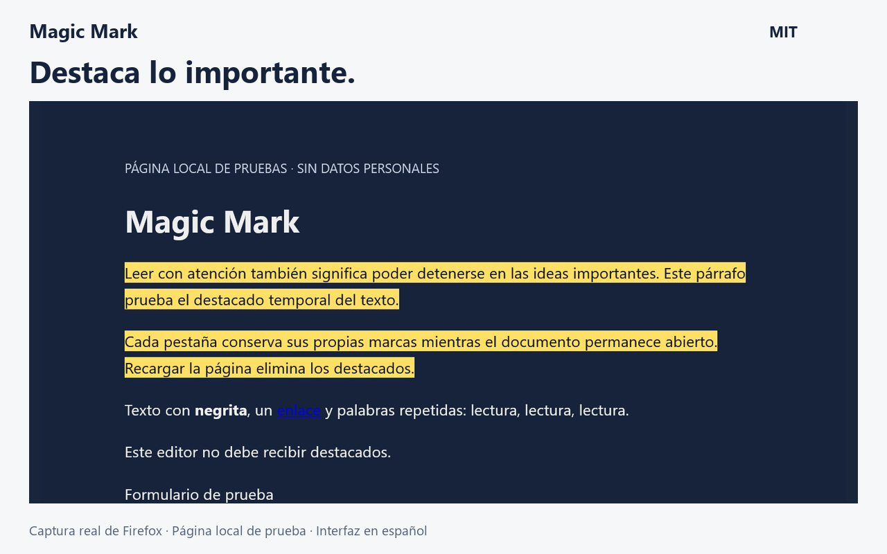
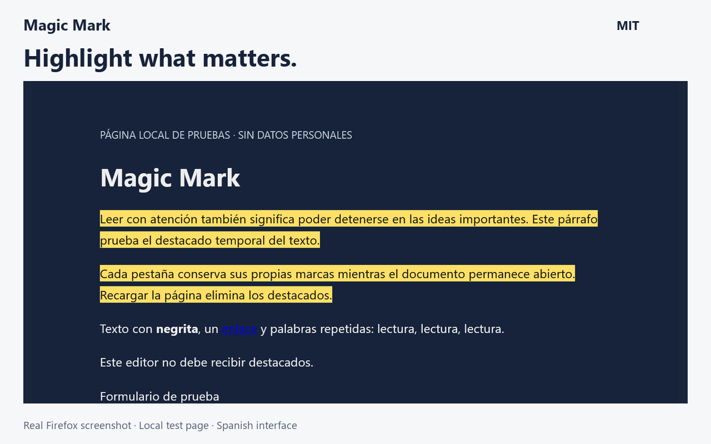

# Magic Mark

## Español

**Destaca lo importante mientras lees.** Extensión gratuita y de código abierto para marcar texto temporalmente en Firefox y navegadores basados en Chromium.

Selecciona texto y pulsa el icono de Magic Mark o usa su menú contextual. Puedes destacar varios párrafos en distintas pestañas, deshacer la última marca o borrar las del documento.

Las marcas desaparecen al recargar, salir del documento o cerrar la pestaña. El navegador también puede perderlas al descargar una pestaña para ahorrar memoria. No hay historial, sincronización ni recuperación.

### Privacidad y recursos

Sin cuentas, anuncios, analítica ni envíos de datos. No guarda selecciones ni URLs en almacenamiento persistente o de sesión. Solo mantiene referencias a rangos en memoria volátil del documento mientras hay marcas. Sin frameworks, dependencias de ejecución, temporizadores ni seguimiento continuo. Hasta 500 rangos por documento. El navegador y el sistema operativo administran la memoria; no se garantiza borrado físico seguro. Consulta [privacidad](PRIVACY.md).

### Instalación de desarrollo

Todavía no está disponible en tiendas. Requiere Node.js 24 LTS y Python 3.10+ para construir desde el código:

```sh
npm ci --ignore-scripts
npm run build
```

- **Firefox 140+ de escritorio:** abre `about:debugging#/runtime/this-firefox`, elige «Cargar complemento temporal» y selecciona `dist/firefox/manifest.json`. La instalación temporal termina al reiniciar Firefox. Los paquetes aún no están firmados.
- **Chrome 123+ y Chromium compatibles:** abre el gestor de extensiones, activa el modo desarrollador y carga la carpeta descomprimida `dist/chromium`.

Los atajos son opcionales; asígnalos desde el navegador. La interfaz actual está en español. Solo funciona con texto HTML seleccionable: no incluye PDF integrado, imágenes, páginas internas/protegidas ni editores. El botón actúa en el documento principal; el menú puede actuar en el marco seleccionado si tiene permiso. Los sitios dinámicos pueden perder marcas al reemplazar texto. Android no forma parte del alcance probado.

### Desarrollo y comunidad

```sh
npm run verify
```

Comprueba sintaxis, once pruebas, construcción, lint de Firefox y paquetes ZIP con SHA-256/CRC. No firma ni publica. `dist`, `artifacts`, dependencias y navegadores de prueba son archivos locales generados y no forman parte del repositorio. Las pruebas ampliadas y sus requisitos están en [VALIDATION.md](VALIDATION.md); el alcance de compatibilidad está en [ROADMAP.md](ROADMAP.md).

[Contribuir](CONTRIBUTING.md) · [Soporte](SUPPORT.md) · [Seguridad](SECURITY.md) · [Pasos para publicar](PUBLICAR.md).

Proyecto comunitario sin fines de lucro bajo [MIT](LICENSE). Permite modificación, redistribución y uso comercial por terceros, conservando los avisos; sin garantía. Procedencia de activos en [LICENSING.md](LICENSING.md).



## English

**Highlight what matters as you read.** A free, open-source extension for temporary text highlights in Firefox and Chromium-based browsers.

Select text and click Magic Mark or use its context menu. Highlight several paragraphs across tabs, undo the latest highlight or clear the document.

Highlights disappear when you reload, leave the document or close the tab. Browser tab discarding can also remove them. There is no history, synchronization or recovery.

### Privacy and resources

No accounts, advertising, analytics or data transmission. Selections and URLs are not saved in persistent or session storage. Only range references remain in the document's volatile memory while highlights exist. No frameworks, runtime dependencies, timers or continuous monitoring. Up to 500 ranges per document. The browser and operating system manage memory; secure physical erasure is not guaranteed. See [privacy](PRIVACY.md).

### Development installation

Not available in stores yet. Building from source requires Node.js 24 LTS and Python 3.10+:

```sh
npm ci --ignore-scripts
npm run build
```

- **Desktop Firefox 140+:** open `about:debugging#/runtime/this-firefox`, choose “Load Temporary Add-on” and select `dist/firefox/manifest.json`. Temporary installation ends on browser restart. Packages are unsigned.
- **Chrome 123+ and compatible Chromium browsers:** open the extension manager, enable developer mode and load the unpacked `dist/chromium` folder.

Shortcuts are optional; assign them in your browser. The current interface uses Spanish labels. Selectable HTML text only: built-in PDFs, images, internal/protected pages and editors are excluded. The button targets the main document; the menu can target the selected frame when permitted. Dynamic sites may lose highlights when replacing text. Android is outside the tested scope.

### Development and community

```sh
npm run verify
```

Checks syntax, eleven tests, build, Firefox lint and ZIP SHA-256/CRC. Does not sign or publish. `dist`, `artifacts`, dependencies and test browsers are generated locally and excluded from the repository. Extended tests and requirements are in [VALIDATION.md](VALIDATION.md); compatibility scope is in [ROADMAP.md](ROADMAP.md).

[Contribute](CONTRIBUTING.md) · [Support](SUPPORT.md) · [Security](SECURITY.md) · [Publishing steps](PUBLICAR.md).

A community nonprofit project under [MIT](LICENSE). Modification, redistribution and third-party commercial use are allowed while preserving notices; without warranty. Asset provenance is recorded in [LICENSING.md](LICENSING.md).


